# Mis Tareas — Aplicación Móvil con Periféricos Nativos

Aplicación móvil multiplataforma de gestión de tareas con estética *"Paper & Ink Notebook"*, construida sobre una arquitectura desacoplada por capas en **React Native, Expo y TypeScript**. Integra periféricos internos del dispositivo como cámara, galería, geolocalización GPS y autenticación biométrica, junto con gestión segura de permisos, almacenamiento local offline aislado por perfil y pruebas automatizadas con **Jest** y **Playwright**.

Desarrollada para el **Instituto Profesional San Sebastián** como entrega de la **Evaluación Sumativa — Unidad N° 2** de la asignatura **Desarrollo de Aplicaciones Móviles — Sección 51**.

| | |
| :--- | :--- |
| **Desarrolladora** | Gina Norambuena Sánchez |
| **Docente** | Boris Belmar |
| **Asignatura** | Desarrollo de Aplicaciones Móviles — Sección 51 |
| **Institución** | Instituto Profesional San Sebastián |
| **Evaluación** | Evaluación Sumativa — Unidad N° 2 |

---

## Tabla de contenidos

- [Características](#características)
- [Tecnologías y Stack Nativo](#tecnologías-y-stack-nativo)
- [Requisitos](#requisitos)
- [Puesta en marcha](#puesta-en-marcha)
  - [1. Clonar el repositorio e instalar dependencias](#1-clonar-el-repositorio-e-instalar-dependencias)
  - [2. Configurar variables de entorno](#2-configurar-variables-de-entorno)
  - [3. Levantar el servidor de desarrollo](#3-levantar-el-servidor-de-desarrollo)
- [Comandos útiles](#comandos-útiles)
- [Variables de entorno](#variables-de-entorno)
- [Arquitectura de la Aplicación](#arquitectura-de-la-aplicación)
  - [Estructura de Directorios](#estructura-de-directorios)
  - [Diagrama de Capas y Periféricos](#diagrama-de-capas-y-periféricos)
- [Implementación de Periféricos](#implementación-de-periféricos)
  - [1. Cámara y Galería](#1-cámara-y-galería)
  - [2. Geolocalización GPS](#2-geolocalización-gps)
  - [3. Autenticación Biométrica](#3-autenticación-biométrica)
- [Gestión de Permisos, Seguridad y Almacenamiento Local](#gestión-de-permisos-seguridad-y-almacenamiento-local)
  - [Permisos Declarativos y Solicitud Just-In-Time](#permisos-declarativos-y-solicitud-just-in-time)
  - [Seguridad y Privacidad Multi-Perfil](#seguridad-y-privacidad-multi-perfil)
  - [Almacenamiento Local Offline](#almacenamiento-local-offline)
- [Pruebas de Funcionalidad, Fiabilidad y Precisión](#pruebas-de-funcionalidad-fiabilidad-y-precisión)
  - [Pruebas Unitarias y Cobertura con Jest](#pruebas-unitarias-y-cobertura-con-jest)
  - [Pruebas End-to-End con Playwright](#pruebas-end-to-end-con-playwright)
- [Evidencia Visual](#evidencia-visual)
  - [Flujo Principal en Aplicación](#flujo-principal-en-aplicación)
  - [Evidencia en Dispositivo Físico](#evidencia-en-dispositivo-físico)

---

## Características

- **Gestión completa de tareas:** Creación, edición, completado con barra de progreso reactiva, eliminación con diálogo de confirmación, filtros por estado `Todas`, `Pendientes` y `Hechas`, y búsqueda en tiempo real por título, descripción o dirección GPS.
- **Captura fotográfica y galería:** Toma directa de fotografías con la cámara nativa o selección desde galería, optimización automática a JPEG hasta `1080px` de ancho, visualización del nombre real del archivo, vista previa ampliada y limpieza automática de archivos descartados.
- **Geolocalización GPS:** Registro de coordenadas de latitud y longitud, precisión estimada en metros, resolución de dirección legible mediante geocodificación inversa y continuidad total sin conexión a internet.
- **Autenticación local multi-perfil con PIN y biometría:** Perfiles independientes protegidos mediante PIN de 4 dígitos con `SHA-256` y `SecureStore`, desbloqueo biométrico por Huella Digital o Face ID exclusivo para el propietario principal del dispositivo, y bloqueo temporal tras intentos fallidos.
- **Operación 100% offline:** Persistencia local aislada por usuario mediante `AsyncStorage` y `expo-file-system`, sin dependencia de servicios web externos.

---

## Tecnologías y Stack Nativo

El proyecto evoluciona sobre la base técnica en **React Native, Expo SDK 58 y TypeScript**, accediendo directamente a los periféricos internos del dispositivo mediante módulos oficiales de Expo:

| Dependencia | Versión | Periférico / Responsabilidad | Archivo Principal |
| :--- | :---: | :--- | :--- |
| **`expo`** | `~58.0.21` | Runtime nativo, config plugins y CLI multiplataforma. | `app.json` |
| **`react-native`** | `0.88.1` | Renderizado nativo Android e iOS sobre motor Hermes. | `App.tsx` |
| **`typescript`** | `~6.0.3` | Tipado estático estricto separado entre código fuente y pruebas. | `tsconfig.json` |
| **`expo-image-picker`** | `~58.0.10` | Acceso a cámara nativa y galería del dispositivo. | `src/infra/device/camera.service.ts` |
| **`expo-image-manipulator`** | `~58.0.16` | Redimensionamiento hasta `1080px` y compresión JPEG al 70%. | `src/infra/device/camera.service.ts` |
| **`expo-file-system`** | `~58.0.14` | Persistencia física en `Paths.document/task-photos/` y limpieza local. | `src/infra/device/camera.service.ts` |
| **`expo-location`** | `~58.0.22` | Lectura GPS, verificación de servicio y geocodificación inversa. | `src/infra/device/location.service.ts` |
| **`expo-local-authentication`** | `~58.0.3` | Sensor biométrico para Huella Digital, Face ID, rostro e iris. | `src/infra/device/biometric.service.ts` |
| **`expo-secure-store`** | `~58.0.3` | Almacenamiento cifrado de credenciales en Keychain y Keystore. | `src/infra/storage/profile-storage.adapter.ts` |
| **`expo-crypto`** | `~58.0.8` | Hashing criptográfico `SHA-256` para PINs de usuario. | `src/infra/storage/profile-storage.adapter.ts` |
| **`@react-native-async-storage/async-storage`** | `2.2.0` | Persistencia local clave-valor aislada por perfil. | `src/infra/storage/task-storage.adapter.ts` |
| **`react-native-paper`** | `^5.15.3` | Primitivas Material 3 para modales, diálogos, `Snackbar` y `FAB`. | `src/components/ui/` |
| **`jest` + `ts-jest`** | `^30.5.2` | Pruebas unitarias y reporte de cobertura sobre servicios nativos. | `src/__tests__/` |
| **`@playwright/test`** | `^1.65.1` | Pruebas End-to-End en viewport móvil `412×915`. | `e2e/todo-peripherals.spec.ts` |

---

## Requisitos

- **Node.js 22 LTS o superior**
- **Gestor de paquetes JavaScript** como `npm`, `pnpm`, `yarn` o `bun`
- **Expo Go** instalado en un dispositivo físico Android o iOS para probar cámara nativa, GPS real y biometría
- **Google Chrome** o navegadores de Playwright instalados con `npx playwright install chromium` para ejecutar la suite E2E

---

## Puesta en marcha

### 1. Clonar el repositorio e instalar dependencias

```bash
git clone https://github.com/ginans/todo-list-mobile-IPSS.git
cd todo-list-mobile-IPSS
npm install
```

### 2. Configurar variables de entorno

Crear el archivo `.env` en la raíz a partir de `.env.example`:

```bash
cp .env.example .env
```

### 3. Levantar el servidor de desarrollo

```bash
# Modo móvil para escanear con Expo Go en Android o iOS
npm start

# Modo navegador web responsivo
npm run web
```

---

## Comandos útiles

| Comando | Descripción |
| :--- | :--- |
| `npm start` | Inicia Metro Bundler para ejecutar la aplicación en dispositivo físico con Expo Go. |
| `npm run android` | Inicia el proyecto apuntando a un dispositivo o emulador Android. |
| `npm run ios` | Inicia el proyecto apuntando a un simulador iOS. |
| `npm run web` | Levanta la versión web en `http://localhost:8081`. |
| `npm run typecheck` | Valida tipos TypeScript tanto en la aplicación como en las pruebas automatizadas. |
| `npm test` | Ejecuta las 4 suites unitarias con Jest y sus 42 casos de prueba. |
| `npm run test:coverage` | Ejecuta las pruebas unitarias generando la tabla de cobertura por módulo. |
| `npm run test:e2e` | Ejecuta la batería End-to-End en Playwright con 4 escenarios móviles. |

---

## Variables de entorno

| Variable | Valor por defecto | Descripción |
| :--- | :---: | :--- |
| `EXPO_PUBLIC_DATA_SOURCE` | `local` | Define el origen de datos. En esta etapa opera exclusivamente en modo local. |
| `EXPO_PUBLIC_API_URL` | `http://localhost:3000/api` | URL base reservada para `TaskHttpAdapter`, mantenido desacoplado bajo el Principio Abierto/Cerrado para futuras integraciones REST. |
| `EXPO_PUBLIC_APP_ENV` | `development` | Identificador del entorno de ejecución. |

---

## Arquitectura de la Aplicación

El diseño separa los contratos de dominio en `src/core/`, los servicios de hardware y persistencia en `src/infra/`, la gestión de estado reactivo en `src/hooks/` y la interfaz en `src/components/`.

### Estructura de Directorios

```text
todo-list-mobile-ipss/
├── App.tsx                                    # Orquestador principal, vistas y modales
├── app.json                                   # Permisos nativos Android/iOS y config plugins
├── jest.config.js                             # Configuración de pruebas unitarias con ts-jest
├── playwright.config.ts                       # Configuración E2E en viewport móvil 412x915
├── tsconfig.json / tsconfig.test.json         # Tipado estricto separado entre app y pruebas
├── e2e/
│   └── todo-peripherals.spec.ts               # Flujos E2E de foto, GPS, PIN y multi-perfil
├── screenshots/
│   └── u2/                                    # Capturas de evidencia Unidad N° 2
└── src/
    ├── config/env.config.ts                   # Lectura tipada de variables EXPO_PUBLIC_*
    ├── constants/messages.constants.ts        # Mensajes centralizados de auth, periféricos y CRUD
    ├── core/                                  # Contratos puros: interfaces, enums y types
    │   ├── auth/
    │   ├── device/
    │   └── task/
    ├── hooks/
    │   ├── useAuthProfiles.ts                 # Ciclo de perfiles, PIN y biometría
    │   └── useTasks.ts                        # CRUD reactivo, filtros, búsqueda y métricas
    ├── infra/
    │   ├── device/
    │   │   ├── biometric.service.ts           # Huella Digital, Face ID y Reconocimiento Facial
    │   │   ├── camera.service.ts              # Cámara, galería, compresión JPEG y FileSystem
    │   │   └── location.service.ts            # GPS, validación de rangos y geocodificación
    │   ├── storage/
    │   │   ├── profile-storage.adapter.ts     # SHA-256, SecureStore, rate limit y borrado en cascada
    │   │   └── task-storage.adapter.ts        # Persistencia local aislada por perfil
    │   └── api/
    │       ├── adapters/task-http.adapter.ts  # Adaptador HTTP reservado para futuras iteraciones
    │       └── factories/task-adapter.factory.ts
    ├── components/
    │   ├── auth/                              # ProfileAuthScreen y ProfileSettingsModal
    │   ├── tasks/                             # TaskHeader, TaskFilterTabs, TaskItem y TaskFormModal
    │   └── ui/                                # AppButton, AppCard, AppInput y AppPermissionDialog
    └── __tests__/                             # 4 suites unitarias Jest con 42 casos de prueba
```

### Diagrama de Capas y Periféricos

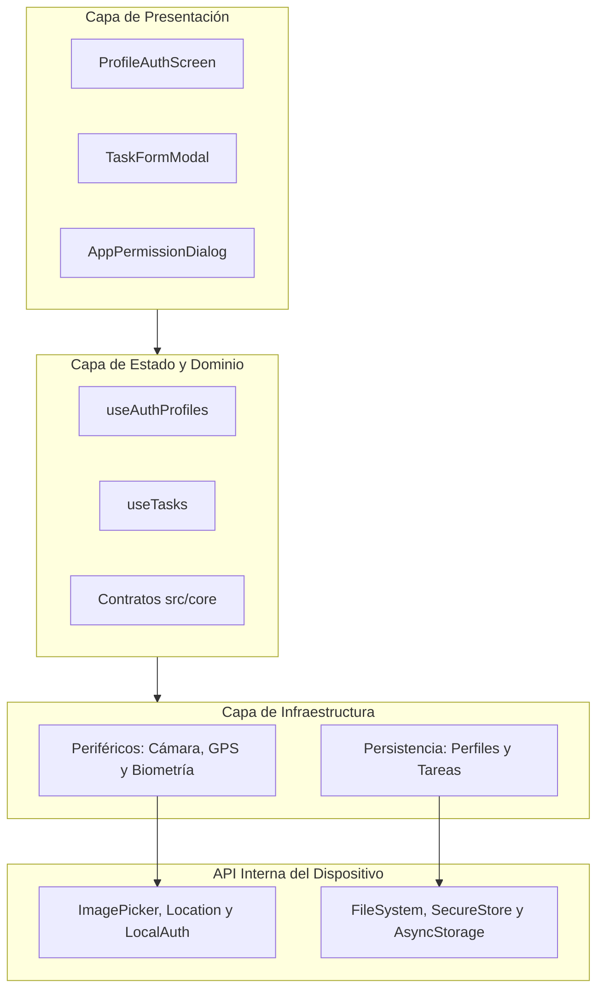

---

## Implementación de Periféricos

### 1. Cámara y Galería

Implementado en [`src/infra/device/camera.service.ts`](./src/infra/device/camera.service.ts) e integrado en [`src/components/tasks/TaskFormModal.tsx`](./src/components/tasks/TaskFormModal.tsx):

- **Captura nativa y galería:** Soporta toma directa con cámara mediante `captureFromCamera` y selección desde galería mediante `pickFromGallery`, conservando el nombre real del archivo o generando un identificador legible con fecha y hora como `Foto_20-11_21-40.jpg` para capturas de cámara.
- **Optimización y límite de tamaño:** Valida que el archivo de entrada no supere `15 MB` antes de decodificarlo para proteger la memoria del dispositivo; luego procesa cada fotografía con `expo-image-manipulator`, redimensionando proporcionalmente hasta un máximo de `1080px` de ancho sin alterar imágenes más pequeñas y aplicando compresión JPEG al 70% para reducir el peso en almacenamiento.
- **Persistencia y limpieza local:** En Android e iOS las imágenes se guardan en el directorio administrado `Paths.document/task-photos/` y se eliminan automáticamente al descartar la selección, reemplazar la foto, eliminar una tarea o borrar un perfil. En Web se persisten en formato `data:image/jpeg;base64`.

### 2. Geolocalización GPS

Implementado en [`src/infra/device/location.service.ts`](./src/infra/device/location.service.ts):

- **Verificación de servicio activo:** Antes de consultar coordenadas en dispositivos nativos, valida con `Location.hasServicesEnabledAsync()` que el servicio de ubicación del sistema se encuentre habilitado.
- **Obtención ágil de coordenadas:** Prioriza lecturas recientes en caché del sistema de hasta 2 minutos y precisión de hasta `200 m` para responder de forma inmediata; si no existe una fijación reciente, solicita posición activa con `Accuracy.Balanced`, límite de 5 segundos y fallback controlado, permitiendo continuar editando el formulario mientras se resuelve la ubicación.
- **Validación de precisión y soporte offline:** `isValidCoordinates()` verifica rangos geográficos válidos de `-90` a `90` en latitud y `-180` a `180` en longitud, descartando lecturas inválidas. Registra la precisión estimada en metros y resuelve una dirección legible mediante `reverseGeocodeAsync()`, conservando las coordenadas formateadas a 4 decimales cuando el dispositivo opera sin conexión.

### 3. Autenticación Biométrica

Implementado en [`src/infra/device/biometric.service.ts`](./src/infra/device/biometric.service.ts):

- **Detección multi-sensor:** Reconoce `FINGERPRINT` para Huella Digital, `FACIAL_RECOGNITION` para Face ID en iOS o Reconocimiento Facial en Android e `IRIS`, validando tanto la presencia de hardware como el enrolamiento previo en el sistema operativo.
- **Exclusividad biométrica para el perfil principal:** En un dispositivo compartido con múltiples perfiles, únicamente el perfil principal propietario puede vincular biometría para evitar que el dueño del teléfono desbloquee cuadernos de terceros con su propia huella o rostro. Los perfiles adicionales operan estrictamente con su PIN de 4 dígitos.

---

## Gestión de Permisos, Seguridad y Almacenamiento Local

### Permisos Declarativos y Solicitud Just-In-Time

- **Android en `app.json`:** `CAMERA`, `ACCESS_FINE_LOCATION`, `ACCESS_COARSE_LOCATION`, `USE_BIOMETRIC` y `USE_FINGERPRINT`.
- **iOS en `app.json`:** `NSCameraUsageDescription`, `NSPhotoLibraryUsageDescription`, `NSLocationWhenInUseUsageDescription` y `NSFaceIDUsageDescription`, configurados mediante los plugins oficiales `expo-image-picker`, `expo-location`, `expo-local-authentication` y `expo-secure-store`.
- **Principio de mínimo privilegio:** Los permisos se solicitan únicamente cuando el usuario activa el periférico correspondiente. Todos los servicios propagan `PermissionStatus` y la bandera nativa `canAskAgain` hacia [`AppPermissionDialog`](./src/components/ui/AppPermissionDialog.tsx):
  - **Rechazo temporal con `canAskAgain` en `true`:** muestra una explicación contextual y ofrece el botón **«Reintentar solicitud»**.
  - **Denegación permanente con `canAskAgain` en `false`:** ofrece acceso directo **«Abrir Configuración»** mediante `Linking.openSettings()`.

### Seguridad y Privacidad Multi-Perfil

| Medida de Seguridad | Implementación |
| :--- | :--- |
| **Hashing criptográfico de PIN** | `SHA-256` con salt por perfil mediante `expo-crypto` para evitar el almacenamiento en texto plano. |
| **Almacenamiento cifrado** | En Android e iOS el hash del PIN se resguarda en Keystore y Keychain mediante `expo-secure-store`, con respaldo en `AsyncStorage` solo en entorno Web. |
| **Protección contra fuerza bruta** | Bloqueo temporal de 30 segundos tras 5 intentos fallidos consecutivos de PIN por perfil. |
| **Protección al iniciar la aplicación** | Al abrir la aplicación se preselecciona el último perfil utilizado desde `LAST_PROFILE_KEY` y se solicita PIN o biometría para acceder al cuaderno. |
| **Borrado en cascada** | Eliminar un perfil purga sus tareas, borra sus fotos físicas en disco, elimina su secreto en `SecureStore` y libera su caché en `TaskAdapterFactory`. |

### Almacenamiento Local Offline

- [`TaskStorageAdapter`](./src/infra/storage/task-storage.adapter.ts) almacena cada cuaderno bajo una clave aislada `@todo_tasks_v2_<profileId>`, persistiendo `photoUri`, `photoName`, `photoSizeKb` y el objeto `location` con `latitude`, `longitude`, `accuracy`, `address` y `capturedAt`.
- Toda escritura confirma primero `AsyncStorage.setItem` antes de actualizar la caché en memoria y propaga posibles fallos hacia el `Snackbar` de [`App.tsx`](./App.tsx).
- [`ProfileSettingsModal`](./src/components/auth/ProfileSettingsModal.tsx) despliega en tiempo real las métricas locales del perfil activo: total de tareas, cantidad de fotos, espacio acumulado en `KB` y registros GPS.

---

## Pruebas de Funcionalidad, Fiabilidad y Precisión

| Nivel | Herramienta | Comando | Resultado |
| :--- | :--- | :--- | :---: |
| **Tipado Estático** | TypeScript en modo estricto | `npm run typecheck` | **0 errores** |
| **Pruebas Unitarias** | Jest y `ts-jest` | `npm run test:coverage` | **4 suites · 42/42 tests pasando** |
| **Pruebas End-to-End** | Playwright en viewport `412×915` | `npm run test:e2e` | **4/4 escenarios pasando** |

### Pruebas Unitarias y Cobertura con Jest

| Módulo | Sentencias | Funciones | Casos Clave Validados |
| :--- | :---: | :---: | :--- |
| `biometric.service.ts` | **92.5%** | **100%** | Huella Digital, Face ID en iOS, Reconocimiento Facial en Android, ausencia de hardware, falta de enrolamiento, cancelación, rechazo y excepciones nativas. |
| `location.service.ts` | **90.6%** | **91.7%** | Validación de rangos geográficos, formateo a 4 decimales, verificación de servicio GPS activo, lectura en caché, timeout de 5 segundos con fallback, resiliencia offline y `canAskAgain`. |
| `camera.service.ts` | **88.4%** | **87.5%** | Permisos denegados con `canAskAgain`, rechazo de archivos sobre `15 MB`, redimensionamiento sobre `1080px`, preservación hasta `1080px`, optimización JPEG al 70%, limpieza de temporales, nombre de archivo, galería, persistencia Web y borrado restringido a `task-photos/`. |
| `task-storage.adapter.ts` | **91.7%** | **100%** | Aislamiento entre perfiles, persistencia de foto y GPS, limpieza física al reemplazar, quitar o eliminar fotos y propagación de fallos de escritura. |
| `profile-storage.adapter.ts` | **74.8%** | **87.0%** | Hashing `SHA-256` en `SecureStore`, bloqueo de 30 segundos tras 5 fallos, rechazo de nombres duplicados, exclusividad biométrica de un solo propietario y borrado en cascada. |

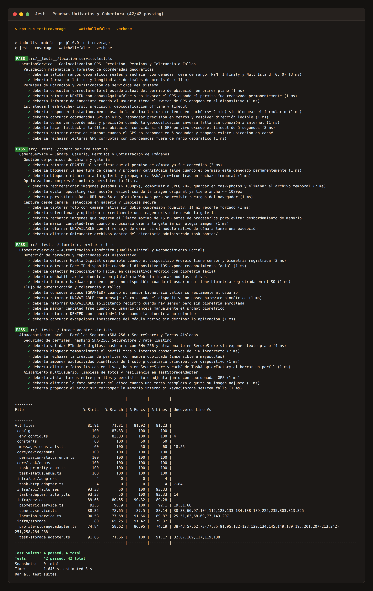

### Pruebas End-to-End con Playwright

1. **Ciclo completo con periféricos:** Creación de perfil con PIN, adjunto de imagen desde galería `evidencia-cafe.png` y captura GPS geolocalizada en `-33.4489, -70.6693`, vista previa ampliada, completado al `100%` y eliminación con confirmación.
2. **Protección de sesión:** Verificación de solicitud de PIN al recargar la aplicación, rechazo de PIN inválido y desbloqueo con PIN correcto.
3. **Aislamiento multi-perfil:** Creación de dos perfiles independientes validando que las tareas privadas de uno no son visibles en el otro.
4. **Límite de tamaño de imagen:** Intento de carga de una imagen de `16 MB` validando el rechazo inmediato en el formulario con el mensaje de límite máximo de `15 MB`.

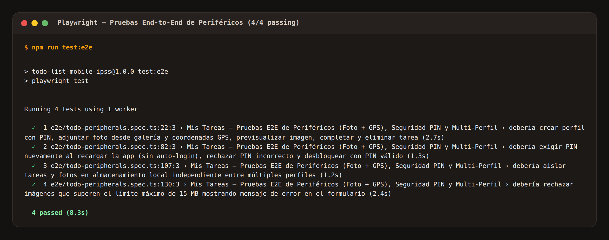

---

## Evidencia Visual

### Flujo Principal en Aplicación

| 1. Creación de Perfil con PIN | 2. Bloqueo al Reabrir y Validación de PIN | 3. Formulario con Foto Adjunta y GPS |
| :---: | :---: | :---: |
| 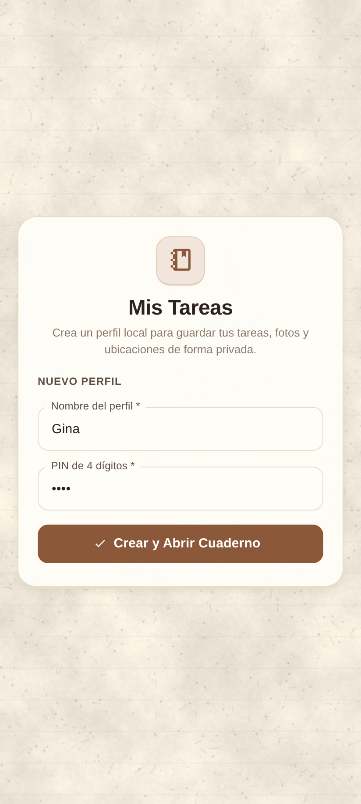 | 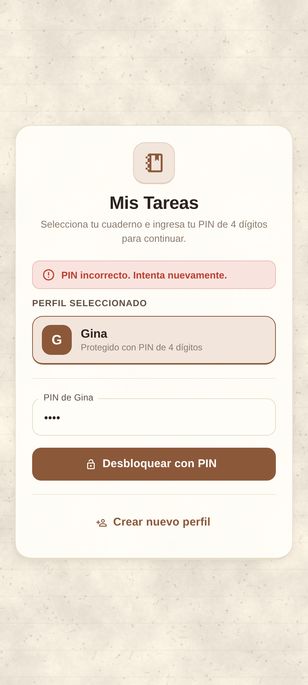 | 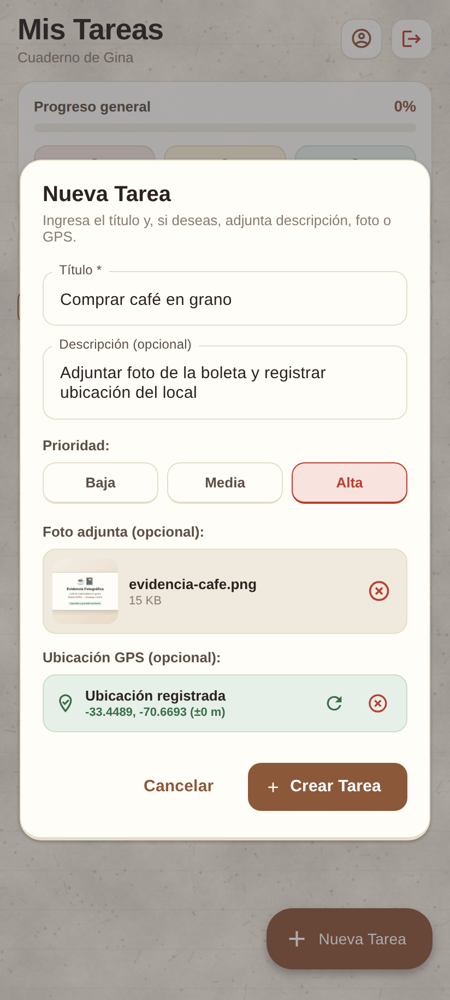 |

| 4. Dashboard con Foto Adjunta y Coordenadas GPS | 5. Vista Previa Ampliada de Fotografía | 6. Administración de Perfil y Métricas Locales |
| :---: | :---: | :---: |
| 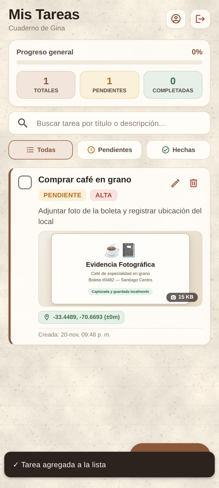 | 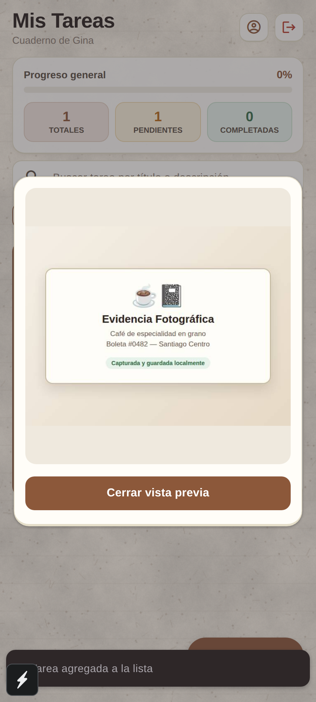 | 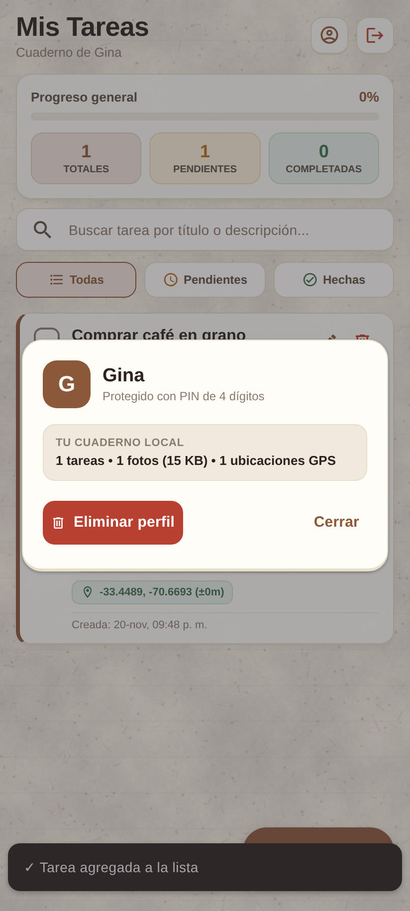 |

### Evidencia en Dispositivo Físico

Capturas tomadas directamente en dispositivo físico Android ejecutando **Expo Go**. Por privacidad, la dirección exacta y las coordenadas fueron difuminadas en las capturas, y el diálogo biométrico nativo no admite captura de pantalla debido a la protección de seguridad `FLAG_SECURE` del sistema operativo.

| 1. Permiso Nativo de Cámara | 2. Permiso Nativo de Ubicación GPS |
| :---: | :---: |
| 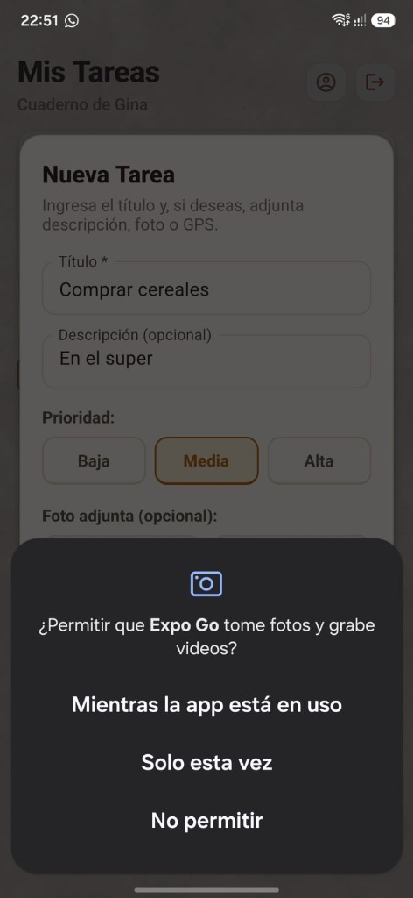 | 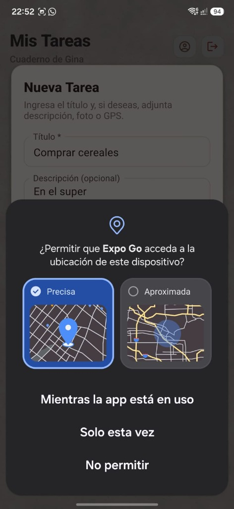 |

| 3. Captura Real con Cámara y Registro GPS | 4. Tarea Guardada con Foto y Dirección GPS |
| :---: | :---: |
| 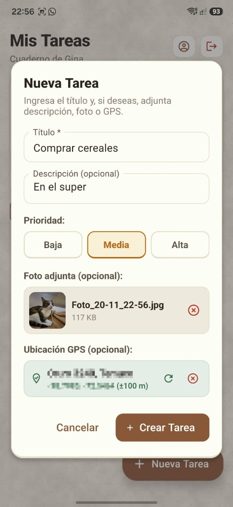 | 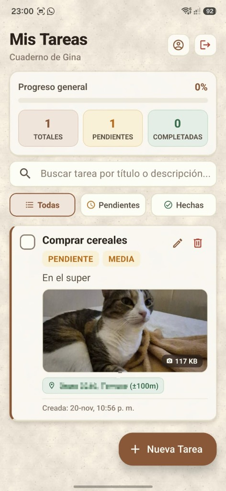 |
