# Mis Tareas — Aplicación Móvil de Gestión de Pendientes (To-Do List)

Aplicación móvil multiplataforma orientada a la organización y seguimiento de tareas diarias (*To-Do List*), construida bajo una arquitectura desacoplada por capas, persistencia local asíncrona y una identidad visual inspirada en cuadernos de notas físicos (*Paper & Ink Notebook*). Desarrollada con fines académicos para el **Instituto Profesional San Sebastián (IPSS)** como entrega de la **Evaluación Sumativa Unidad N° 1** de la asignatura **Desarrollo de Aplicaciones Móviles — Sección 51**.

| | |
| :--- | :--- |
| **Desarrolladora** | Gina Norambuena Sánchez |
| **Docente** | Boris Belmar |
| **Asignatura** | Desarrollo de Aplicaciones Móviles — Sección 51 |
| **Institución** | Instituto Profesional San Sebastián (IPSS) |
| **Evaluación** | Evaluación Sumativa Unidad N° 1 |

---

## Tabla de contenidos

- [Mis Tareas — Aplicación Móvil de Gestión de Pendientes (To-Do List)](#mis-tareas--aplicación-móvil-de-gestión-de-pendientes-to-do-list)
  - [Tabla de contenidos](#tabla-de-contenidos)
  - [Características](#características)
  - [Tecnologías y Justificación del Stack](#tecnologías-y-justificación-del-stack)
  - [Requisitos](#requisitos)
  - [Puesta en marcha](#puesta-en-marcha)
    - [1. Clonar el repositorio e instalar dependencias](#1-clonar-el-repositorio-e-instalar-dependencias)
    - [2. Configurar variables de entorno](#2-configurar-variables-de-entorno)
    - [3. Instalar EAS CLI, iniciar sesión y levantar el servidor](#3-instalar-eas-cli-iniciar-sesión-y-levantar-el-servidor)
    - [4. Abrir la aplicación en el teléfono o navegador](#4-abrir-la-aplicación-en-el-teléfono-o-navegador)
  - [Comandos útiles](#comandos-útiles)
  - [Variables de entorno](#variables-de-entorno)
  - [Arquitectura de la Aplicación](#arquitectura-de-la-aplicación)
    - [Funcionamiento Nativo en React Native](#funcionamiento-nativo-en-react-native)
    - [Estructura de Directorios](#estructura-de-directorios)
    - [Diagrama de Arquitectura por Capas](#diagrama-de-arquitectura-por-capas)
    - [Diagrama de Flujo Funcional](#diagrama-de-flujo-funcional)
  - [Patrones de Diseño y Decisiones Arquitectónicas](#patrones-de-diseño-y-decisiones-arquitectónicas)
    - [1. Adapter Pattern (`ITaskRepository`, `TaskStorageAdapter`, `TaskHttpAdapter`)](#1-adapter-pattern-itaskrepository-taskstorageadapter-taskhttpadapter)
    - [2. Factory \& Singleton Pattern (`TaskAdapterFactory`)](#2-factory--singleton-pattern-taskadapterfactory)
    - [3. Container / Presenter Pattern (`useTasks` Custom Hook)](#3-container--presenter-pattern-usetasks-custom-hook)
    - [4. Componentes Atómicos Reutilizables (`src/components/ui/`)](#4-componentes-atómicos-reutilizables-srccomponentsui)
    - [5. Separación Estricta de Contratos y Hojas de Estilo](#5-separación-estricta-de-contratos-y-hojas-de-estilo)
    - [Balance Arquitectónico (Trade-offs)](#balance-arquitectónico-trade-offs)
  - [Estrategia UX/UI: Estética *"Paper \& Ink Notebook"*](#estrategia-uxui-estética-paper--ink-notebook)
  - [Vistas y Flujo del Sistema](#vistas-y-flujo-del-sistema)
    - [1. Estado Inicial y Creación de Tareas](#1-estado-inicial-y-creación-de-tareas)
    - [2. Panel de Progreso, Prioridades y Tachado de Completadas](#2-panel-de-progreso-prioridades-y-tachado-de-completadas)
    - [3. Edición de Tareas y Eliminación con Confirmación](#3-edición-de-tareas-y-eliminación-con-confirmación)
    - [4. Filtros por Estado y Búsqueda en Tiempo Real](#4-filtros-por-estado-y-búsqueda-en-tiempo-real)
  - [Nota sobre el proceso de desarrollo](#nota-sobre-el-proceso-de-desarrollo)

---

## Características

- **Ciclo CRUD Completo de Tareas:**
  - Registro de tareas con **título obligatorio** (validado en tiempo real), **descripción opcional** y selector de **prioridad** (`Baja`, `Media`, `Alta`).
  - Edición interactiva precargando los datos actuales de la tarea seleccionada.
  - Marcado y desmarcado instantáneo de estado (`Pendiente` / `Completada`) con tachado reactivo tanto en el título como en la descripción.
  - Eliminación protegida mediante diálogo modal de confirmación (`AppConfirmDialog`) para evitar borrados accidentales.
- **Panel de Progreso General Reactivo:**
  - Barra de avance porcentual dinámica que cambia a verde salvia al alcanzar el `100%` de cumplimiento.
  - Tres cajas contadoras integradas bajo la barra de progreso: **Totales** (tinta/café), **Pendientes** (ámbar/ocre) y **Completadas** (verde salvia).
- **Búsqueda y Filtrado Instantáneo:**
  - Buscador en tiempo real por coincidencias de texto en título o descripción.
  - Pestañas de filtro (`Todas`, `Pendientes`, `Hechas`) con íconos vectoriales y bordes con relieve.
- **Persistencia Local con `AsyncStorage` y Feature Flag:**
  - En esta primera unidad, las tareas se almacenan de forma persistente en el dispositivo mediante `TaskStorageAdapter` (`@react-native-async-storage/async-storage`), iniciando con una lista limpia (`0` tareas).
  - La capa de infraestructura ya incluye `TaskHttpAdapter` controlado por la variable `EXPO_PUBLIC_DEMO_MODE`, dejando la aplicación lista para conectarse a un backend REST API en las siguientes unidades sin tocar la interfaz.
- **Sistema de Diseño *"Paper & Ink Notebook"*:**
  - Lienzo con textura orgánica de papel algodón (`assets/paper-texture.png`), paleta cálida de papelería (`#F4EFE6`, `#FFFDF8`) y tinta espresso (`#2C221E`), junto con coherencia cromática entre los botones del formulario y las insignias (`AppBadge`) del dashboard.

---

## Tecnologías y Justificación del Stack

Se seleccionó **React Native con Expo y TypeScript** por cuatro motivos técnicos:

1. **Renderizado Nativo Real frente a WebViews:** A diferencia de frameworks híbridos basados en *WebView*, React Native traduce los componentes en vistas nativas reales del sistema operativo (`android.view.View` en Android y `UIView` en iOS), logrando 60 FPS y respuesta táctil nativa.
2. **Tipado Estático Estricto:** El uso de TypeScript permite modelar contratos de dominio claros (`interfaces`, `types`, `enums`) y detectar errores antes de ejecutar la aplicación en el teléfono.
3. **Entorno de Desarrollo Multiplataforma con Expo SDK 58:** Permite compilar y probar en tiempo real directamente en dispositivos físicos mediante **Expo Go** (y en paralelo en navegador web o tablet) sin requerir instalaciones pesadas para el flujo diario de desarrollo.
4. **Evolución hacia Unidades 2 y 3:** La asignatura contempla escalar este proyecto hacia autenticación y consumo de APIs REST. Contar con React Native + TypeScript permite dejar preparada la capa de adaptadores HTTP desde la primera entrega.

| Dependencia | Versión | Propósito y Justificación de Elección |
| :--- | :---: | :--- |
| **`expo`** | `~58.0.21` | SDK y CLI local (`npx expo`) que gestiona Metro Bundler, carga de recursos gráficos, variables `EXPO_PUBLIC_*` y vinculación con Expo Go. |
| **`react-native`** | `0.88.1` | Framework móvil nativo con soporte para la Nueva Arquitectura (motor Hermes y comunicación vía JSI). |
| **`react`** | `19.3.0` | Biblioteca declarativa de interfaz y manejo de estado reactivo mediante Hooks. |
| **`typescript`** | `~6.0.3` | Tipado estático estricto para contratos de dominio, adaptadores y propiedades de componentes. |
| **`react-native-paper`** | `^5.15.3` | Primitivas accesibles de Material Design 3 (`Modal`, `Portal`, `Snackbar`, `TextInput`, `Surface`, `FAB`) utilizadas como base interna de nuestra capa `src/components/ui/`. |
| **`@react-native-async-storage/async-storage`** | `2.2.0` | Almacenamiento clave-valor asíncrono y persistente en el teléfono. Se eligió para conservar las tareas localmente en la Unidad 1 a través de `TaskStorageAdapter`. |
| **`@expo/vector-icons`** | `^15.0.2` | Iconografía vectorial (`MaterialCommunityIcons`) para filtros, buscador y controles de acción. |
| **`react-native-safe-area-context`** | `~5.10.1` | Cálculo automático de zonas seguras del hardware (cámara frontal, barra de estado y barra inferior de gestos). |
| **`react-native-screens`** | `~4.30.0` | Optimización de contenedores nativos de pantalla en memoria. |
| **`react-native-web` & `react-dom`** | `^0.21.4` | Renderizado compatible en navegador web para pruebas rápidas de diseño responsivo. |

---

## Requisitos

- **Node.js 20+** o **Node.js 22+** *(Node.js 18 no se utiliza por encontrarse deprecado)*
- **npm** (incluido con Node.js)
- **EAS CLI (`eas-cli`)** instalado globalmente (`npm install -g eas-cli`)
- **Cuenta gratuita en [Expo](https://expo.dev/)** y aplicación **Expo Go** instalada en el teléfono desde Google Play Store o App Store.

---

## Puesta en marcha

### 1. Clonar el repositorio e instalar dependencias

```bash
git clone https://github.com/ginans/todo-list-mobile-IPSS.git
cd todo-list-mobile-IPSS
npm install
```

### 2. Configurar variables de entorno

Crear el archivo `.env` en la raíz del proyecto a partir de `.env.example`:

```bash
cp .env.example .env
```

```env
EXPO_PUBLIC_DEMO_MODE=true
EXPO_PUBLIC_API_URL=http://localhost:3000/api
EXPO_PUBLIC_APP_ENV=development
```

### 3. Instalar EAS CLI, iniciar sesión y levantar el servidor

Si aún no tienes **EAS CLI** instalado globalmente, instálalo e inicia sesión con tu cuenta de Expo (la misma cuenta activa en la app **Expo Go** del teléfono). Luego, inicia el servidor de desarrollo:

```bash
npm install -g eas-cli
eas login
npm start
```

> **Nota:** Al autenticarse mediante `eas login`, tu sesión de Expo queda vinculada con **Expo Go** en el teléfono y `npm start` (`npx expo start`) genera el código QR interactivo en la terminal. Si la red Wi-Fi bloquea conexiones locales entre dispositivos, puedes iniciar en modo túnel ejecutando `npx expo start --tunnel`. Para más información sobre la configuración de **EAS CLI** y distribución en dispositivos, consultar la [documentación oficial de Expo](https://docs.expo.dev/develop/development-builds/share-with-your-team/).

### 4. Abrir la aplicación en el teléfono o navegador

- **En Dispositivo Móvil (Expo Go):** Abre la app **Expo Go** en tu smartphone (donde aparecerá el servidor activo bajo tu cuenta de Expo) o escanea directamente el código QR de la terminal.
- **En Navegador Web:** Presiona la tecla `w` en la terminal o ejecuta `npm run web` (`http://localhost:8081`).

---

## Comandos útiles

| Comando | Descripción |
| :--- | :--- |
| `npm install -g eas-cli` | Instala globalmente la herramienta de línea de comandos de Expo Application Services (EAS) |
| `eas login` | Inicia sesión en la cuenta de Expo desde la terminal para vincular dispositivos |
| `eas whoami` | Verifica el usuario de Expo actualmente autenticado en la terminal |
| `npm start` | Levanta el servidor de desarrollo de Expo y genera el código QR |
| `npx expo start -c` | Inicia el servidor limpiando la caché de Metro Bundler |
| `npx expo start --tunnel` | Inicia el servidor usando túnel remoto (útil en redes con firewall) |
| `npm run android` | Ejecuta la aplicación en emulador o teléfono Android conectado por USB |
| `npm run web` | Ejecuta la versión web en `http://localhost:8081` |
| `npx tsc --noEmit` | Verifica el tipado de TypeScript en todo el proyecto sin emitir archivos |

---

## Variables de entorno

Las variables prefijadas con `EXPO_PUBLIC_` son leídas de forma centralizada en `src/config/env.config.ts`:

| Variable | Valor por defecto | Descripción |
| :--- | :---: | :--- |
| `EXPO_PUBLIC_DEMO_MODE` | `true` | **Feature Flag de datos:** `true` utiliza `TaskStorageAdapter` (`AsyncStorage` local); `false` activa `TaskHttpAdapter` (API REST). |
| `EXPO_PUBLIC_API_URL` | `http://localhost:3000/api` | URL base del servicio backend para las siguientes unidades. |
| `EXPO_PUBLIC_APP_ENV` | `development` | Entorno de ejecución actual (`development` \| `production`). |

---

## Arquitectura de la Aplicación

### Funcionamiento Nativo en React Native

La aplicación aprovecha la **Nueva Arquitectura de React Native** (`"newArchEnabled": true` en `app.json`), dividiendo el trabajo en dos planos comunicados por **JSI (JavaScript Interface)**:
- **Capa JavaScript (Hermes Engine):** Ejecuta la lógica de negocio en TypeScript, el hook `useTasks` y la persistencia asíncrona en `AsyncStorage`.
- **Capa Nativa (Host Platform):** Renderiza los componentes fundamentales del proyecto en vistas reales del sistema:
  - **`FlatList`:** Virtualiza el listado de tareas mediante *windowing*, manteniendo en memoria únicamente las tarjetas visibles en pantalla.
  - **`ImageBackground`:** Renderiza la textura de papel algodón (`assets/paper-texture.png`) a pantalla completa.
  - **`KeyboardAvoidingView` & `SafeAreaView`:** Ajustan automáticamente la interfaz cuando se despliega el teclado virtual (como se aprecia al escribir una tarea) y respetan los márgenes de cámara y barra de estado.
  - **`Portal` & `Modal`:** Elevan los diálogos flotantes por encima del árbol principal de vistas.

### Estructura de Directorios

```text
todo-list-mobile-ipss/
├── assets/
│   └── paper-texture.png                 # Textura orgánica de papel algodón
├── screenshots/                          # Capturas de pantalla reales en dispositivo móvil
├── src/
│   ├── config/
│   │   └── env.config.ts                 # Lectura tipada de variables de entorno
│   ├── core/                             # Capa de Dominio (Contratos desacoplados)
│   │   └── task/
│   │       ├── enums/                    #   task-priority.enum.ts, task-status.enum.ts
│   │       ├── interfaces/               #   task.interface.ts, task-filter.interface.ts, task-repository.interface.ts
│   │       └── types/                    #   create-task.type.ts, update-task.type.ts
│   ├── infra/                            # Capa de Infraestructura y Persistencia
│   │   └── api/
│   │       ├── adapters/
│   │       │   ├── task-storage.adapter.ts # Persistencia local en AsyncStorage (@todo_tasks_v2)
│   │       │   └── task-http.adapter.ts    # Cliente HTTP fetch preparado para Unidad 2
│   │       └── factories/
│   │           └── task-adapter.factory.ts # Selección de adaptador según Feature Flag
│   ├── components/                       # Capa de Presentación
│   │   ├── ui/                           #   Primitivos reutilizables (AppBadge, AppButton, AppCard, AppConfirmDialog, AppInput)
│   │   │   └── styles/                   #     Hojas de estilo atómicas (*.styles.ts)
│   │   └── tasks/                        #   Componentes de negocio (TaskHeader, TaskFilterTabs, TaskItem, TaskFormModal, TaskEmptyState)
│   │       └── styles/                   #     Hojas de estilo de dominio (*.styles.ts)
│   ├── hooks/
│   │   └── useTasks.ts                   # Custom Hook de estado CRUD, búsqueda, filtros y métricas
│   ├── styles/
│   │   └── app.styles.ts                 # Estilos globales de pantalla y botón flotante (FAB)
│   └── theme/
│       └── app-theme.ts                  # Paleta "Paper & Ink" y tokens semánticos
├── .env.example                          # Plantilla de variables de entorno
├── App.tsx                               # Punto de entrada principal
├── app.json                              # Configuración de Expo
└── package.json                          # Dependencias y scripts
```

### Diagrama de Arquitectura por Capas

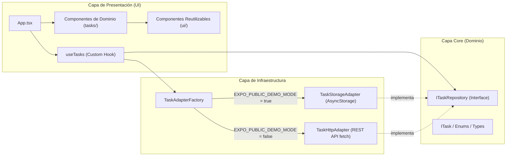

### Diagrama de Flujo Funcional

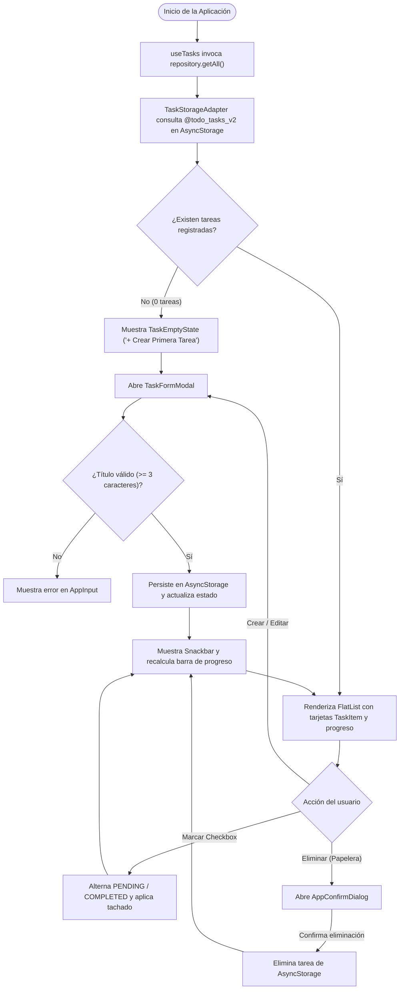

---

## Patrones de Diseño y Decisiones Arquitectónicas

### 1. Adapter Pattern (`ITaskRepository`, `TaskStorageAdapter`, `TaskHttpAdapter`)

Para desacoplar la interfaz móvil del mecanismo de almacenamiento, se definió el contrato `ITaskRepository` en `src/core/task/interfaces/task-repository.interface.ts`:

```typescript
export interface ITaskRepository {
  getAll(): Promise<ITask[]>;
  getById(id: string): Promise<ITask | null>;
  create(input: CreateTaskInput): Promise<ITask>;
  update(id: string, input: UpdateTaskInput): Promise<ITask>;
  delete(id: string): Promise<boolean>;
}
```

- **`TaskStorageAdapter` (Activo actualmente):** Implementa la persistencia local usando `AsyncStorage` bajo la clave `@todo_tasks_v2`. Inicia con una colección vacía (`[]`) y guarda cada cambio en el teléfono.
- **`TaskHttpAdapter` (Preparado para Unidad 2):** Implementa el mismo contrato mediante peticiones `fetch` (`GET`, `POST`, `PATCH`, `DELETE`) hacia un servidor REST.

### 2. Factory & Singleton Pattern (`TaskAdapterFactory`)

Resuelve dinámicamente qué adaptador entregar al hook `useTasks` según el valor de `envConfig.isDemoMode`, manteniendo una única instancia en memoria durante la ejecución:

```typescript
export class TaskAdapterFactory {
  private static instance: ITaskRepository | null = null;

  public static getRepository(): ITaskRepository {
    if (!TaskAdapterFactory.instance) {
      if (envConfig.isDemoMode) {
        TaskAdapterFactory.instance = new TaskStorageAdapter();
      } else {
        TaskAdapterFactory.instance = new TaskHttpAdapter(envConfig.apiUrl);
      }
    }
    return TaskAdapterFactory.instance;
  }
}
```

### 3. Container / Presenter Pattern (`useTasks` Custom Hook)

El hook `src/hooks/useTasks.ts` centraliza las operaciones CRUD, el estado de carga, la búsqueda por texto, el filtro por estado y el cálculo de métricas (`total`, `pending`, `completed`, `progress`), manteniendo a los componentes visuales libres de lógica de persistencia.

### 4. Componentes Atómicos Reutilizables (`src/components/ui/`)

Siguiendo la filosofía de sistemas como `shadcn/ui`, las primitivas de `react-native-paper` se encapsularon en componentes propios (`AppCard`, `AppButton`, `AppInput`, `AppBadge`, `AppConfirmDialog`). Esto evita acoplar las pantallas a una librería externa y centraliza los estilos del tema en un solo lugar.

### 5. Separación Estricta de Contratos y Hojas de Estilo

- **Modelos separados por tipo de artefacto:** Las enumeraciones se ubican en `enums/*.enum.ts`, las interfaces en `interfaces/*.interface.ts` y los tipos de entrada en `types/*.type.ts`.
- **Carpetas `styles/` dedicadas:** Todos los bloques `StyleSheet.create` están extraídos en archivos `*.styles.ts` dentro de su carpeta `styles/` correspondiente, logrando componentes JSX breves y legibles.

### Balance Arquitectónico (Trade-offs)

Aunque una lista de tareas sencilla podría resolverse en un solo archivo con `useState`, estructurar estas capas permite que en las **Unidades 2 y 3** la conexión con un backend real (por ejemplo, NestJS) requiera únicamente cambiar `EXPO_PUBLIC_DEMO_MODE=false` en `.env`, sin modificar ningún componente visual. Al mismo tiempo, se evitó complejidad innecesaria descartando gestores globales pesados (como Redux) o capas de *Use Cases* redundantes para una sola entidad.

---

## Estrategia UX/UI: Estética *"Paper & Ink Notebook"*

- **Paleta Cálida y Textura de Papel:** Se reemplazó el fondo blanco clínico por una textura de papel algodón (`assets/paper-texture.png`) combinada con tonos crema (`#F4EFE6`, `#FFFDF8`), tinta espresso (`#2C221E`) y acentos cuero/terracota (`#8C583A`).
- **Relieve Táctil y Coherencia Cromática:** Las tarjetas, filtros y botones de prioridad cuentan con bordes inferiores acentuados (`borderBottomWidth`) que simulan hojas de papel apiladas. Tanto los botones del formulario como las pills (`AppBadge`) en las tarjetas comparten la misma semántica de color:
  - **Baja:** Verde salvia (`#3B6E4C` / `#E6F0E8`)
  - **Media:** Ámbar / Ocre (`#B86B19` / `#FBF0D9`)
  - **Alta:** Terracota / Rojo (`#B84030` / `#F9E3DF`)
- **Usabilidad centrada en la agilidad:**
  - **Descripción opcional:** Permite anotar recordatorios rápidos ingresando solo el título; si una tarea no tiene descripción, la tarjeta compacta su diseño automáticamente.
  - **Tachado instantáneo:** Al completar una tarea, tanto el título como la descripción aplican línea tachada (`line-through`) y cambian su indicador lateral a verde.
  - **Adaptabilidad multi-pantalla:** Se construyeron barras de progreso y selectores flexibles a medida que mantienen sus proporciones tanto en smartphones como en tablets y navegadores web.

---

## Vistas y Flujo del Sistema

### 1. Estado Inicial y Creación de Tareas

Al iniciar por primera vez, la aplicación comienza en `0` tareas con un estado vacío limpio (`TaskEmptyState`). Al abrir el modal de nueva tarea, el teclado respeta los campos de entrada (`KeyboardAvoidingView`), permite elegir la prioridad y confirma la creación mediante un `Snackbar` inferior.

| Estado Inicial Vacío (0%) | Modal Nueva Tarea con Teclado | Tarea Creada + Notificación |
| :---: | :---: | :---: |
| 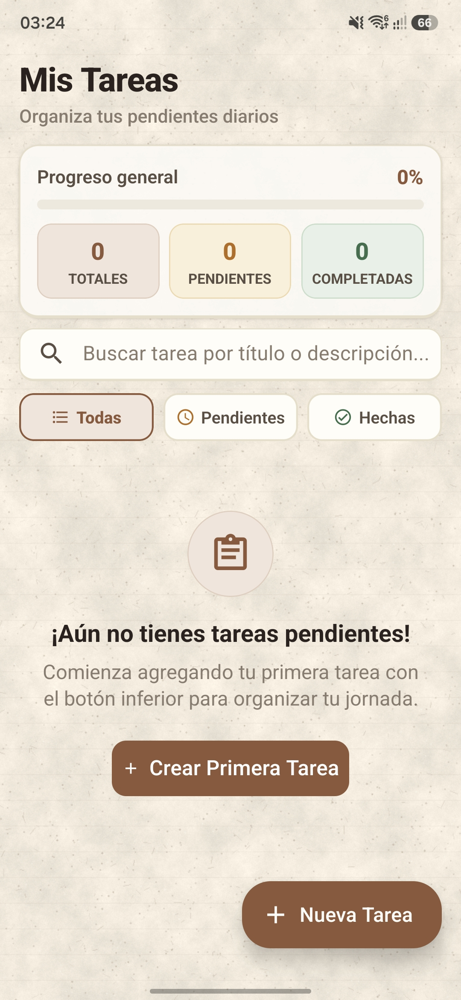 | 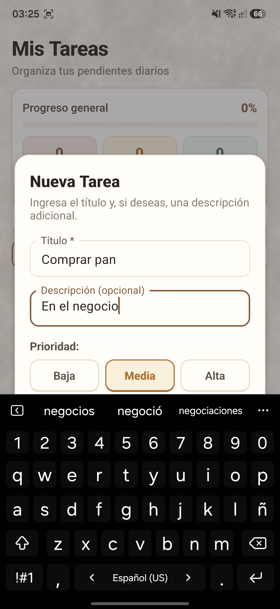 | 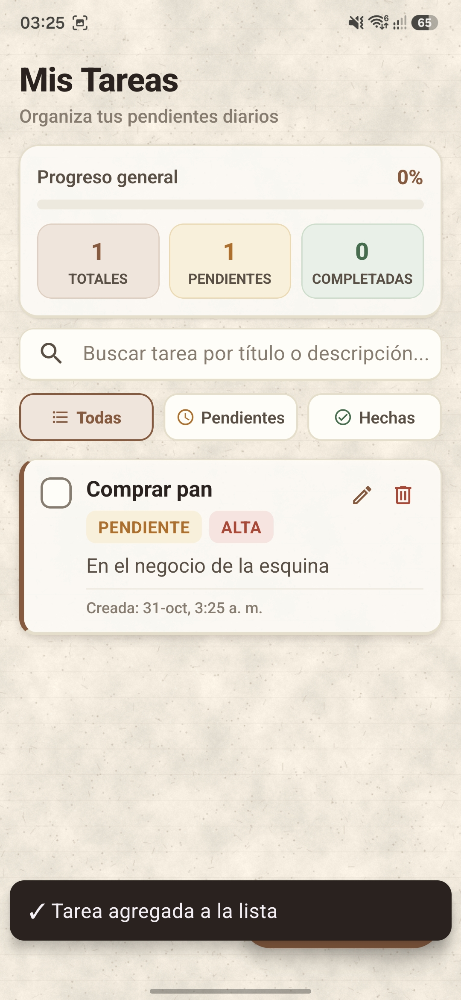 |

---

### 2. Panel de Progreso, Prioridades y Tachado de Completadas

A medida que se registran y completan tareas, el panel superior recalcula en tiempo real el porcentaje de avance y los contadores (`Totales`, `Pendientes`, `Completadas`). Las tareas marcadas como hechas aplican tachado automático en su título y descripción, y al completar todas las tareas la barra alcanza el `100%` en color verde.

| Listado y Prioridades (20%) | Tareas Tachadas y Avance (60%) | Progreso Completado (100%) |
| :---: | :---: | :---: |
| 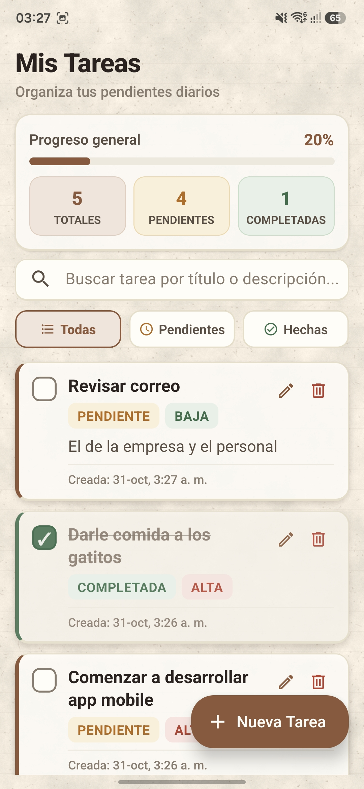 | 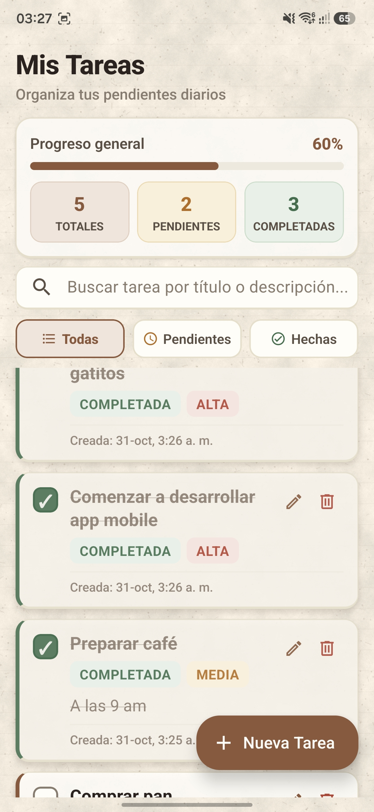 | 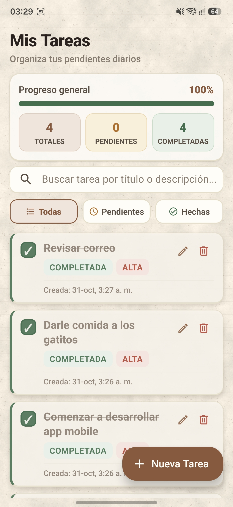 |

---

### 3. Edición de Tareas y Eliminación con Confirmación

Cada tarjeta permite editar sus datos precargando el formulario modal (`Editar Tarea`) o eliminar el registro tras confirmar la acción en el diálogo de seguridad (`AppConfirmDialog`).

| Modal de Edición de Tarea | Diálogo de Confirmación de Borrado | Tarea Eliminada + Recálculo |
| :---: | :---: | :---: |
| 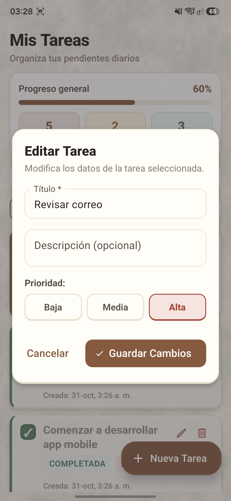 | 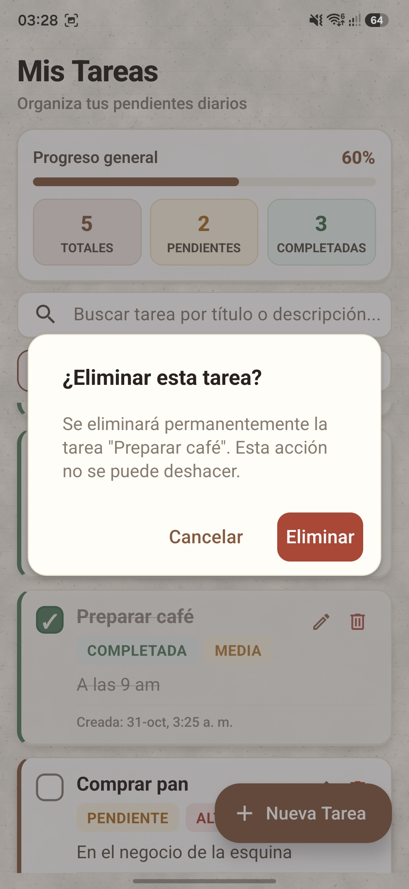 | 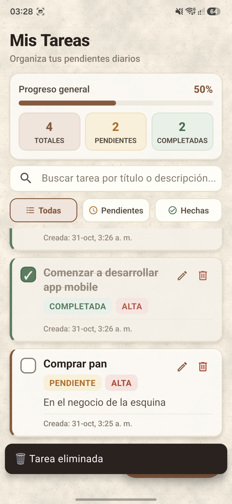 |

---

### 4. Filtros por Estado y Búsqueda en Tiempo Real

El usuario puede alternar entre las pestañas `Todas`, `Pendientes` y `Hechas`, o filtrar instantáneamente por texto mediante la barra de búsqueda.

| Filtro: Pestaña Pendientes | Filtro: Pestaña Hechas | Búsqueda Instantánea (`"Pan"`) |
| :---: | :---: | :---: |
| 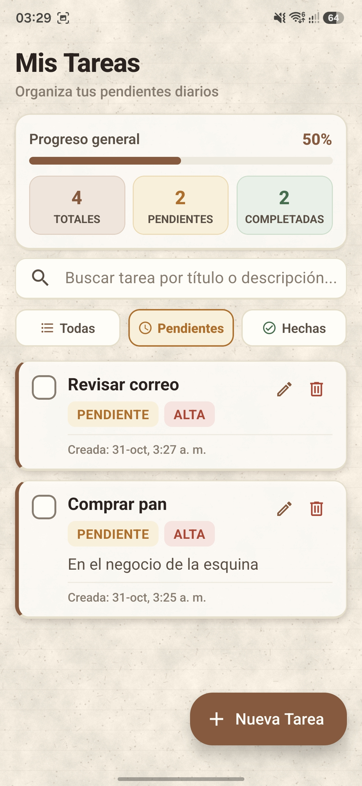 | 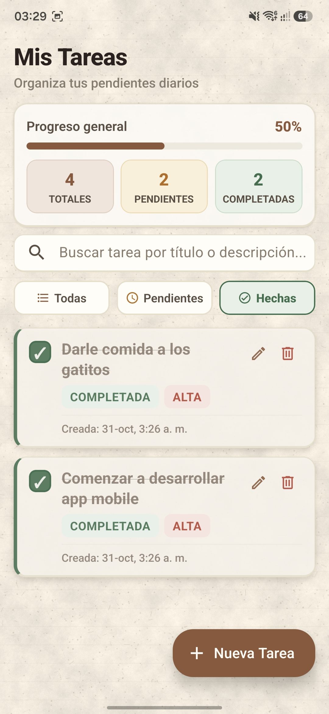 | 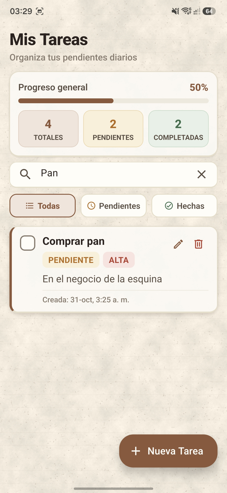 |

---

## Nota sobre el proceso de desarrollo

Este proyecto fue desarrollado con el apoyo de herramientas avanzadas de inteligencia artificial (el agente de programación `Antigravity` de Google DeepMind) para agilizar tareas de maquetación de estilos, refactorización de componentes en React Native, tipado estricto en TypeScript y estructuración documental.

El uso de estas herramientas se enmarca en una metodología de **pair programming colaborativo**, donde la **definición de la arquitectura desacoplada por capas, la estrategia de persistencia con Feature Flags, la identidad visual *"Paper & Ink"*, las pruebas en dispositivos físicos y cada decisión técnica y de experiencia de usuario fueron dirigidas, evaluadas y supervisadas en todo momento por la desarrolladora Gina Norambuena Sánchez**, quien actuó como **arquitecta principal de la aplicación**, validando cada cambio antes de su integración al repositorio.
